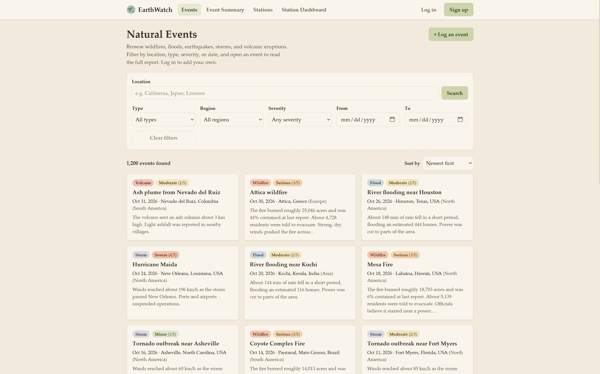
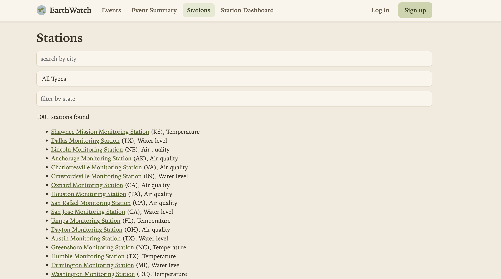

# EarthWatch

A web app for recording and exploring natural events and tracking environmental monitoring stations, built with Node, Express, MongoDB, and React.

- **Live site:** [EarthWatch on Render](https://earthwatch-wypx.onrender.com/)
- **Design documents:**
  - Station Monitor (Milena): [Design document](docs/design-document-stations.pdf)
  - Event Tracker (Rishabh): [Design document](docs/design-document-events.pdf)
- **Video demo and presentation:** [Video on Youtube](https://youtu.be/npgU2CwNGDI)
- **Slides:** [Presentation](https://docs.google.com/presentation/d/1Qz0Sjyxqo3-u8Q1FVkZ5AhkGZG1RbhNE5olrmL1allw/edit?usp=sharing)





## Project Objective

The objective was to build a full-stack web application with Node + Express + MongoDB + a React (hooks) frontend that gives people one place to record and explore natural events and to track environmental readings over time. News about wildfires, floods, earthquakes, and storms is scattered across news sites and social media, and local readings like air quality and river levels are buried in specialist tools. EarthWatch has two independent features, each with its own MongoDB collection:

- **Event Tracker** (`/events`, `/events/summary`): log natural events and explore them by type, severity, location, and date
- **Station Monitor**: manage environmental monitoring stations and record readings to see how conditions change

Anyone can browse events and stations, but users must create an account and log in to add them, and only the author can edit or delete their own records.

## Features

### Accounts (shared)

- Sign up, log in, and log out, with authentication done by Passport (local strategy) and sessions stored in MongoDB
- Passwords are hashed with bcrypt before they are saved, and usernames are not case-sensitive
- Pages that need an account send you to the login page, then back to where you were after you log in

### Station Monitor (Milena Perez-Gerus)

- Add a monitoring station with a name, city, state, type (air quality, water level, temperature), and a normal range
- Browse +1,000 stations, with 20 at a time and pagination
- Search by city and filter by station type and state
- Station detail page with the station's full reading history where readings outside the normal range are highlighted in red
- Add, edit, and delete readings on your own stations
- Edit and delete your own stations. Other users don't see these options and the server does not allow changes from anyone but the station's owner
- Station dashboard that ranks 10 stations with the most out-of-range readings in the past week or month built with a MongoDB aggregation pipeline
- **How to use**: open **Stations** in the navigation bar to browse and use the search box and filters to narrow the list. Click a station's name to see its reading history. To add your own, click **Sign up** or **Log in**, then **+ Add station**. Fill in the form. On your station's page, use the reading form to add readings. There are **Edit** and **Delete** buttons for each reading. Open **Station Dashboard** to see which stations had the most out-of-range readings recently.

### Event Tracker (Rishabh Kumar)

- Log an event with a title, type (wildfire, flood, earthquake, storm, volcano), severity from 1 (Minor) to 5 (Extreme), region, location, date, and an optional description
- Browse 1,200+ events, 20 at a time, with **Previous / Next** pagination
- Search by location (e.g. "California" or "Japan") and filter by type, region, minimum severity, and date range, then sort by newest, oldest, or most severe
- Filters and the page number are kept in the URL, so a filtered view can be shared and the Back button works
- Event detail page with the full report and who posted it
- Edit or delete your own events (with a confirmation popup before deleting). Other users don't see these buttons, and the server rejects edits from anyone but the author
- Event Summary page with the number of events by type (with average severity), by month of the year, and by region, all from a single MongoDB aggregation. Narrow it down by year, type, or region, and click a type or region to see those events
- **How to use:** open **Events** in the navigation bar to browse, and use the filters to narrow the list. Click an event's title to read the full report. To add your own, click **Sign up** (or **Log in**), then **+ Log an event**, fill in the form, and click **Add event**. Open one of your events to **Edit** or **Delete** it. Open **Event Summary** to see which events are most common, when they happen, and where.

## GenAI Usage

### Milena Perez-Gerus

Model: Claude Opus 5.5

- Learning: walkthrough of setting up React with Vite, React hooks, and React Router
- Debugging: help reading error messages and fixing bugs in imports
- Dataset: help understanding how to add seed script data to Mockaroo data

### Rishabh Kumar

Model: Claude Opus 5.5 (Claude Code)

- Learning: explanations of Passport sessions stored in MongoDB and MongoDB aggregations
- Testing and verification: testing the API routes and pages, checking ESLint and Prettier, security verification
- Dataset: help with writing Faker seed script to generate the 1,200 synthetic events in `data/events.json`

## Tech Requirements

- React 19 with hooks, built with [Vite](https://vite.dev/), [React Router](https://reactrouter.com/), the Fetch API, and PropTypes
- [Node.js](https://nodejs.org/) + [Express](https://expressjs.com/) (ES modules)
- [MongoDB](https://www.mongodb.com/) with the native Node.js driver (no Mongoose)
- [Passport](https://www.passportjs.org/) (local strategy) with express-session, connect-mongo, and bcryptjs
- [Faker](https://fakerjs.dev/) to generate the synthetic events
- [Mockaroo](https://www.mockaroo.com/) to generate the synthetic stations
- ESLint and Prettier
- Separate `package.json` files for the backend (project root) and the frontend (`frontend/`)

## How to Install and Use

1. Clone the repository:

```bash
   git clone https://github.com/mimiperezg/earthwatch.git
   cd earthwatch
```

2. Install the dependencies:

```bash
   npm install
```

3. Start MongoDB with Docker:

```bash
   docker run --name mongodb -p 27017:27017 -v mongodata:/data/db -d mongodb/mongodb-community-server:latest
```

By default, the app connects to `mongodb://localhost:27017`. To use another database, such as MongoDB Atlas, skip Docker and set the `MONGODB_URI` environment variable, or put it in a `.env` file in the project folder (it is git-ignored, so your credentials stay private):

```bash
   MONGODB_URI=mongodb+srv://<user>:<password>@<cluster>.mongodb.net/
```

4. Import the mock data: in MongoDB Compass, connect to `mongodb://localhost:27017`, create a database named `earthwatch` with a collection named `events`, and import `data/events.json` (1,200 synthetic events). Then load the stations by running `npm run seed:stations`. It reads `db/data/stations.json` (1,000 stations generated with Mockaroo), adds 20 to 50 readings to each one with dates from the last 60 days, and replaces the seeded stations already in the database (stations created by users are kept).

5. Build the frontend and start the server:

```bash
   npm run build
   npm start
```

6. Open [http://localhost:3000](http://localhost:3000).

Use `npm run dev` instead of `npm start` to restart the server automatically when files change.

The events in `data/events.json` are synthetic. The places are real locations where each type of event happens, but the events themselves, their dates, and their details are made up. The stations in `db/data/stations.json` and their readings are also synthetic. The cities and states are real but the stations and readings are made up.

## Authors

- **Milena Perez-Gerus**: [Homepage](https://mimiperezg.github.io/homepageMilenaPerezGerus/) · [GitHub](https://github.com/mimiperezg)
- **Rishabh Kumar**: [Homepage](https://k-rishabh.github.io/) · [GitHub](https://github.com/k-rishabh)

## Class

Created for [CS 5610 Web Development](https://johnguerra.co/classes/webDevelopment_online_fall_2026/) at Northeastern University, taught by John Alexis Guerra Gómez.

## License

This project is licensed under the [MIT License](LICENSE).
